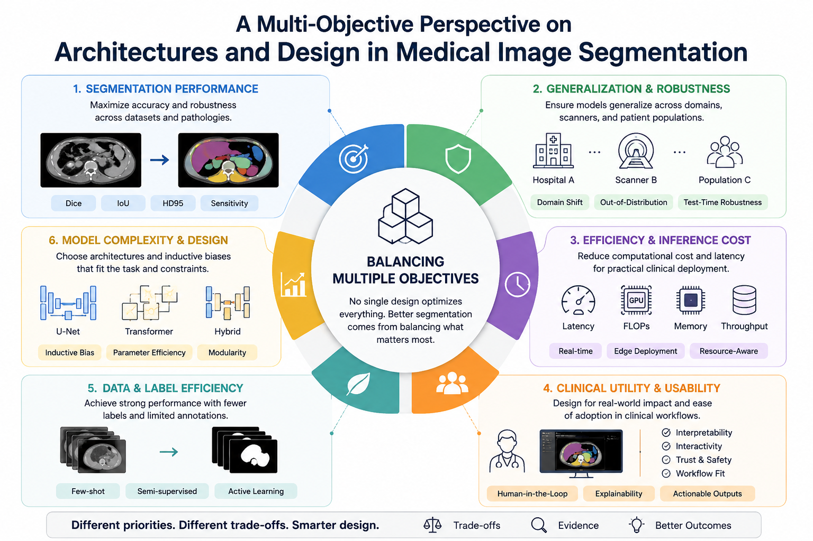

# A Multi-Objective Perspective on Architectures and Design in Medical Image Segmentation

[](https://arxiv.org/abs/2025.XXXXX)
[](https://awesome.re)
[](https://opensource.org/licenses/MIT)
[](https://github.com/yourusername/Medical-Image-Segmentation-Survey/graphs/commit-activity)

<p align="center">
  
</p>

This repository provides a **curated, structured collection** of 100+ methods in medical image segmentation, organized by architectural paradigm. It accompanies our survey paper:

> **A Multi-Objective Perspective on Architectures and Design in Medical Image Segmentation**  
> Nand Kumar Yadav, Moinak Bose, Debesh Jha, and William C. W. Chen  
> University of South Dakota, 2025  
> [[Paper]](https://arxiv.org/abs/2025.XXXXX)

We argue that segmentation architectures operate under **four competing objectives** — local spatial precision, global contextual reasoning, computational efficiency, and cross-domain generalization — and that no single architecture can optimize all four simultaneously (**The Redistribution Law**).

**We welcome contributions!** Feel free to open a pull request when new relevant work is published.

### Newly verified papers (2026)

See the [curated 2026 paper additions](ADDITIONAL_PAPERS_2026.md) and the [machine-readable index](additional_papers_2026.csv) for 12 additional CVPR/MICCAI publications, technical mechanisms, official links, and proposed diagnostic comparisons. This reading list is separate from the manuscript's fixed 95-method inventory and does not change its literature cutoff or supplementary evidence files.


---

## Citation

If you find this repository useful, please cite our survey:

```bibtex
@article{yadav2025multiobjective,
  title={A Multi-Objective Perspective on Architectures and Design in Medical Image Segmentation},
  author={Yadav, Nand Kumar and Jha, Debesh and Chen, William C. W.,and Bose, Moinak },
  journal={arXiv preprint arXiv:2025.XXXXX},
  year={2025}
}
```

---

## Contents

- [Overview](#overview)
- [Benchmarks and Datasets](#benchmarks-and-datasets)
- [CNN-Based Architectures](#cnn-based-architectures)
  - [U-Net and Skip-Based Models](#u-net-and-skip-based-models)
  - [Dense / Multi-Scale CNN Models](#dense--multi-scale-cnn-models)
  - [3D and Volumetric CNN Models](#3d-and-volumetric-cnn-models)
- [Transformer-Based Architectures](#transformer-based-architectures)
  - [Pure Transformer Segmentation](#pure-transformer-segmentation)
  - [CNN–Transformer Hybrid Models](#cnn-transformer-hybrid-models)
  - [Transformer-Enhanced Skip / Fusion](#transformer-enhanced-skip--fusion)
  - [Hierarchical Transformers](#hierarchical-transformers)
  - [Lightweight / Efficient Transformers](#lightweight--efficient-transformers)
  - [Boundary-Aware / Task-Specific Transformers](#boundary-aware--task-specific-transformers)
- [State Space / Mamba-Based Architectures](#state-space--mamba-based-architectures)
  - [Hybrid CNN–SSM Methods](#hybrid-cnn-ssm-methods)
  - [Pure SSM / Mamba Architectures](#pure-ssm--mamba-architectures)
  - [Transformer–Mamba Hybrids](#transformer-mamba-hybrids)
  - [3D Volumetric Mamba Models](#3d-volumetric-mamba-models)
  - [Specialized Mamba Architectures](#specialized-mamba-architectures)
- [SAM and Foundation Models](#sam-and-foundation-models)
  - [Full Fine-Tuning Approaches](#full-fine-tuning-approaches)
  - [Parameter-Efficient Adaptation (LoRA / Adapter)](#parameter-efficient-adaptation-lora--adapter)
  - [3D Volumetric Extensions](#3d-volumetric-extensions)
  - [Two-Stage and Detection-Guided](#two-stage-and-detection-guided)
  - [Hybrid and Architectural Modifications](#hybrid-and-architectural-modifications)
  - [Few-Shot and Support-Based Methods](#few-shot-and-support-based-methods)
  - [Novel Architectural Innovations](#novel-architectural-innovations)
  - [Video and Temporal Extensions](#video-and-temporal-extensions)
  - [Clinical Reasoning and Prompt Engineering](#clinical-reasoning-and-prompt-engineering)
- [Mixture-of-Experts and Adaptive Routing](#mixture-of-experts-and-adaptive-routing)
- [Other Hybrid Architectures](#other-hybrid-architectures)
- [Evaluation Metrics](#evaluation-metrics)

---

## Overview

We decompose segmentation architectures into **three functional components**:

| Component | Purpose | Key Mechanisms |
|---|---|---|
| **Local Feature Extraction** | Preserve edges, textures, fine structures | Convolution, residual/dense blocks, skip connections |
| **Global Context Modeling** | Encode long-range anatomical relations | Self-attention, shifted-window attention, SSM scanning |
| **Feature Fusion & Routing** | Align shallow spatial with deep semantic features | Direct skip → dense skip → gated skip → MoE routing |

### The Four Competing Objectives

| Objective | What It Measures | Best Paradigm |
|---|---|---|
| **Local Precision (LP)** | Boundary accuracy (HD95) | CNNs |
| **Global Context (GC)** | Organ-level consistency (DSC) | Transformers |
| **Computational Efficiency (CE)** | FLOPs, params, latency | SSMs / Mamba |
| **Cross-Domain Generalization (CG)** | Robustness across modalities | Foundation Models (SAM) |

---

## Benchmarks and Datasets

| Dataset | Modality | Task | Link |
|---|---|---|---|
| **Synapse** | CT | Multi-organ abdominal (8 organs) | [[Access]](https://www.synapse.org/) |
| **BTCV** | CT | Multi-organ abdominal | [[Access]](https://www.synapse.org/Synapse:syn3193805/wiki/217789) |
| **AMOS22** | CT/MRI | Multi-organ abdominal (15 organs) | [[Access]](https://zenodo.org/record/7155725) |
| **BraTS** | MRI | Brain tumor segmentation | [[Access]](https://www.synapse.org/brats) |
| **ACDC** | MRI | Cardiac segmentation | [[Access]](https://www.creatis.insa-lyon.fr/Challenge/acdc/) |
| **ISIC** | Dermoscopy | Skin lesion segmentation | [[Access]](https://challenge.isic-archive.com/) |
| **Kvasir-SEG** | Endoscopy | Polyp segmentation | [[Access]](https://datasets.simula.no/kvasir-seg/) |
| **CVC-ClinicDB** | Endoscopy | Polyp segmentation | [[Access]](https://polyp.grand-challenge.org/CVCClinicDB/) |

---

## CNN-Based Architectures

### U-Net and Skip-Based Models

- **U-Net: Convolutional Networks for Biomedical Image Segmentation**  
  *Ronneberger et al.* [MICCAI 2015]  
  [[Paper]](https://arxiv.org/abs/1505.04597) [[Code]](https://github.com/milesial/Pytorch-UNet)

- **UNet++: A Nested U-Net Architecture for Medical Image Segmentation**  
  *Zhou et al.* [DLMIA 2018]  
  [[Paper]](https://arxiv.org/abs/1807.10165) [[Code]](https://github.com/MrGiovanni/UNetPlusPlus)

- **Attention U-Net: Learning Where to Look for the Pancreas**  
  *Oktay et al.* [2018]  
  [[Paper]](https://arxiv.org/abs/1804.03999) [[Code]](https://github.com/ozan-oktay/Attention-Gated-Networks)

- **R2U-Net: Recurrent Residual U-Net for Medical Image Segmentation**  
  *Alom et al.* [2018]  
  [[Paper]](https://arxiv.org/abs/1802.06955)

- **Residual U-Net for Road Extraction**  
  *Zhang et al.* [IEEE GRSL 2018]  
  [[Paper]](https://ieeexplore.ieee.org/document/8309343)

- **DoubleU-Net: A Deep Convolutional Neural Network for Medical Image Segmentation**  
  *Jha et al.* [IEEE CBMS 2020]  
  [[Paper]](https://arxiv.org/abs/2006.04868) [[Code]](https://github.com/DebeshJha/2020-CBMS-DoubleU-Net)

- **KiU-Net: Overcomplete Convolutional Architectures for Biomedical Image and Volumetric Segmentation**  
  *Valanarasu et al.* [IEEE TMI 2021]  
  [[Paper]](https://arxiv.org/abs/2006.04878) [[Code]](https://github.com/jeya-maria-jose/KiU-Net-pytorch)

- **nnU-Net: A Self-Configuring Method for Deep Learning-Based Biomedical Image Segmentation**  
  *Isensee et al.* [Nature Methods 2021]  
  [[Paper]](https://www.nature.com/articles/s41592-020-01008-z) [[Code]](https://github.com/MIC-DKFZ/nnUNet)

### Dense / Multi-Scale CNN Models

- **Dense-UNet: A Novel Multiphoton In Vivo Cellular Image Segmentation Model**  
  *Cai et al.* [QIMS 2020]  
  [[Paper]](https://qims.amegroups.com/article/view/42857)

- **H-DenseUNet: Hybrid Densely Connected UNet for Liver and Tumor Segmentation from CT Volumes**  
  *Li et al.* [IEEE TMI 2018]  
  [[Paper]](https://ieeexplore.ieee.org/document/8379359) [[Code]](https://github.com/xmengli999/H-DenseUNet)

- **CBAM-U-Net: Liver Tumor Segmentation Using CBAM**  
  *Beevi et al.* [2023]  
  [[Paper]](https://link.springer.com/chapter/10.1007/978-981-99-2602-2_1)

### 3D and Volumetric CNN Models

- **3D U-Net: Learning Dense Volumetric Segmentation from Sparse Annotation**  
  *Çiçek et al.* [MICCAI 2016]  
  [[Paper]](https://arxiv.org/abs/1606.06650)
 - **nnU-Net: a self-configuring method for deep learning-based biomedical image segmentation**  
  *Isensee et al.* [Nature Methods]  
  [[Paper]](https://www.nature.com/articles/s41592-020-01008-z) [[Code]](https://github.com/MIC-DKFZ/nnUNet)

---

## Transformer-Based Architectures

### Pure Transformer Segmentation

- **UNETR: Transformers for 3D Medical Image Segmentation**  
  *Hatamizadeh et al.* [WACV 2022]  
  [[Paper]](https://arxiv.org/abs/2103.10504) [[Code]](https://github.com/Project-MONAI/research-contributions/tree/main/UNETR)

- **Swin-Unet: Unet-like Pure Transformer for Medical Image Segmentation**  
  *Cao et al.* [ECCV 2022]  
  [[Paper]](https://arxiv.org/abs/2105.05537) [[Code]](https://github.com/HuCaoFighting/Swin-Unet)

- **nnFormer: Volumetric Medical Image Segmentation via a 3D Transformer**  
  *Zhou et al.* [IEEE TIP 2023]  
  [[Paper]](https://ieeexplore.ieee.org/document/10098338) [[Code]](https://github.com/282857341/nnFormer)

- **MISSFormer: An Effective Medical Image Segmentation Transformer**  
  *Huang et al.* [IEEE TMI 2022]  
  [[Paper]](https://arxiv.org/abs/2109.07162) [[Code]](https://github.com/ZhifangDeng/MISSFormer)

- **UNETR++: Efficient Paired Attention for 3D Medical Segmentation**  
  *Shaker et al.* [IEEE TMI 2025]  
  [[Paper]](https://ieeexplore.ieee.org/abstract/document/10526382) [[Code]](https://github.com/Amshaker/unetr_plus_plus)

### CNN–Transformer Hybrid Models

- **TransUNet: Transformers Make Strong Encoders for Medical Image Segmentation**  
  *Chen et al.* [2021]  
  [[Paper]](https://arxiv.org/abs/2102.04306) [[Code]](https://github.com/Beckschen/TransUNet)

- **CoTr: Efficiently Bridging CNN and Transformer for 3D Medical Image Segmentation**  
  *Xie et al.* [MICCAI 2021]  
  [[Paper]](https://arxiv.org/abs/2103.03024) [[Code]](https://github.com/YtongXie/CoTr)

- **TransBTS: Multimodal Brain Tumor Segmentation Using Transformer**  
  *Wang et al.* [MICCAI 2021]  
  [[Paper]](https://arxiv.org/abs/2103.04430) [[Code]](https://github.com/Wenxuan-1119/TransBTS)

- **TransFuse: Fusing Transformers and CNNs for Medical Image Segmentation**  
  *Zhang et al.* [MICCAI 2021]  
  [[Paper]](https://arxiv.org/abs/2102.08005) [[Code]](https://github.com/Rayicer/TransFuse)

- **Swin UNETR: Swin Transformers for Semantic Segmentation of Brain Tumors in MRI**  
  *Hatamizadeh et al.* [MICCAI BrainLes 2022]  
  [[Paper]](https://arxiv.org/abs/2201.01266) [[Code]](https://github.com/Project-MONAI/research-contributions/tree/main/SwinUNETR)

- **HiFormer: Hierarchical Multi-Scale Representations Using Transformers**  
  *Heidari et al.* [Medical Image Analysis 2023]  
  [[Paper]](https://arxiv.org/abs/2207.08518) [[Code]](https://github.com/amirhossein-kz/HiFormer)

- **H2Former: Hierarchical Hybrid Transformer for Medical Image Segmentation**  
  *He et al.* [Medical Image Analysis 2023]  
  [[Paper]](https://ieeexplore.ieee.org/document/10149585)

### Transformer-Enhanced Skip / Fusion

- **UCTransNet: Rethinking the Skip Connections in U-Net from a Channel-Wise Perspective**  
  *Wang et al.* [AAAI 2022]  
  [[Paper]](https://arxiv.org/abs/2109.04335) [[Code]](https://github.com/McGregorWwww/UCTransNet)

- **UDTransNet: Learnable Skip Connections for Medical Image Segmentation**  
  *Wang et al.* [Neural Networks 2024]  
  [[Paper]](https://www.sciencedirect.com/science/article/pii/S0893608024000200)

- **DAEFormer: Dual Attention Efficient Transformer for Medical Image Segmentation**  
  *Azad et al.* [Medical Image Analysis 2023]  
  [[Paper]](https://arxiv.org/abs/2212.13504) [[Code]](https://github.com/mindflow-institue/DAEFormer)

- **EMCAD: Efficient Multi-Scale Convolutional Attention Decoding for Medical Image Segmentation**  
  *Rahman et al.* [CVPR 2024]  
  [[Paper]](https://arxiv.org/abs/2405.06880) [[Code]](https://github.com/SLDGroup/EMCAD)

- **MERIT: Multi-Scale Encoder with Transformer for Medical Image Segmentation**  
  *Rahman et al.* [IEEE TMI 2023]  
  [[Paper]](https://ieeexplore.ieee.org/document/10197640)

- **PVT-CASCADE: Pyramid Vision Transformer for Medical Segmentation**  
  *Rahman et al.* [Medical Image Analysis 2022]  
  [[Paper]](https://arxiv.org/abs/2404.01786)

### Hierarchical Transformers

- **Swin Transformer: Hierarchical Vision Transformer Using Shifted Windows**  
  *Liu et al.* [ICCV 2021]  
  [[Paper]](https://arxiv.org/abs/2103.14030) [[Code]](https://github.com/microsoft/Swin-Transformer)

- **LeViT-UNet: Make Faster Encoders with Transformer for Medical Image Segmentation**  
  *Xu et al.* [MICCAI 2021]  
  [[Paper]](https://arxiv.org/abs/2107.08623) [[Code]](https://github.com/apple1986/LeViT-UNet)

- **UTNet: A Hybrid Transformer Architecture for Medical Image Segmentation**  
  *Gao et al.* [MICCAI 2021]  
  [[Paper]](https://arxiv.org/abs/2107.00781) [[Code]](https://github.com/yhygao/UTNet)

- **MDFormer: Multi-Scale Dense Dilated Transformer for Medical Image Segmentation**  
  *Li et al.* [Medical Image Analysis 2025]  
  [[Paper]](https://www.sciencedirect.com/science/article/pii/S1361841524003578)

### Lightweight / Efficient Transformers

- **Axial-DeepLab: Stand-Alone Axial-Attention for Panoptic Segmentation**  
  *Wang et al.* [ECCV 2020]  
  [[Paper]](https://arxiv.org/abs/2003.07853) [[Code]](https://github.com/csrhddlam/axial-deeplab)

- **FCT: Fully Convolutional Transformer for Medical Image Segmentation**  
  *Truong et al.* [MICCAI 2021]  
  [[Paper]](https://arxiv.org/abs/2206.00566)

### Boundary-Aware / Task-Specific Transformers

- **BATFormer: Boundary-Aware Transformer for Medical Image Segmentation**  
  *Wang et al.* [IEEE TMI 2023]  
  [[Paper]](https://ieeexplore.ieee.org/document/10147042)

- **SwinPA-Net: Swin Transformer for Polyp Segmentation**  
  *Liu et al.* [Medical Image Analysis 2023]  
  [[Paper]](https://www.sciencedirect.com/science/article/pii/S1361841523002475)

- **FAT-Net: Feature Adaptive Transformer Network**  
  *Wu et al.* [Pattern Recognition 2022]  
  [[Paper]](https://www.sciencedirect.com/science/article/pii/S0031320322003867)

---

## State Space / Mamba-Based Architectures

### Hybrid CNN–SSM Methods

- **U-Mamba: Enhancing Long-Range Dependency for Biomedical Image Segmentation**  
  *Ma et al.* [2024]  
  [[Paper]](https://arxiv.org/abs/2401.04722) [[Code]](https://github.com/bowang-lab/U-Mamba)

- **nnMamba: 3D Biomedical Image Segmentation, Classification and Landmark Detection with State Space Model**  
  *Gong et al.* [IEEE ISBI 2025]  
  [[Paper]](https://arxiv.org/abs/2402.03526) [[Code]](https://github.com/lhaof/nnMamba)

### Pure SSM / Mamba Architectures

- **VM-UNet: Vision Mamba UNet for Medical Image Segmentation**  
  *Ruan et al.* [ACM TOMM 2024]  
  [[Paper]](https://arxiv.org/abs/2402.02491) [[Code]](https://github.com/JCruan519/VM-UNet)

- **Mamba-UNet: UNet-Like Pure Visual Mamba for Medical Image Segmentation**  
  *Wang et al.* [2024]  
  [[Paper]](https://arxiv.org/abs/2402.05079) [[Code]](https://github.com/ziyangwang007/Mamba-UNet)

- **UltraLight VM-UNet: Parallel Vision Mamba Significantly Reduces Parameters for Skin Lesion Segmentation**  
  *Wu et al.* [Patterns 2025]  
  [[Paper]](https://www.cell.com/patterns/fulltext/S2666-3899(25)00266-X)

- **SA-UMamba: Spatial Attention Convolutional Neural Networks for Medical Image Segmentation**  
  *Liu et al.* [PLOS ONE 2025]  
  [[Paper]](https://journals.plos.org/plosone/article?id=10.1371/journal.pone.0325899)

### Transformer–Mamba Hybrids

- **Swin-UMamba: Mamba-Based UNet with ImageNet-Based Pretraining**  
  *Liu et al.* [MICCAI 2024]  
  [[Paper]](https://arxiv.org/abs/2402.03302) [[Code]](https://github.com/JiarunLiu/Swin-UMamba)

### 3D Volumetric Mamba Models

- **SegMamba: Long-Range Sequential Modeling Mamba for 3D Medical Image Segmentation**  
  *Xing et al.* [MICCAI 2024]  
  [[Paper]](https://arxiv.org/abs/2401.13560) [[Code]](https://github.com/ge-xing/SegMamba)

- **SegMamba-V2: Long-Range Sequential Modeling Mamba for General 3D Medical Image Segmentation**  
  *Xing et al.* [IEEE TMI 2025]  
  [[Paper]](https://ieeexplore.ieee.org/document/10937932)

- **HybridMamba: A Dual-Domain Mamba for 3D Medical Image Segmentation**  
  *Wu et al.* [MICCAI 2025]  
  [[Paper]](https://link.springer.com/chapter/10.1007/978-3-031-72111-3_26)

### Specialized Mamba Architectures

- **T-Mamba: A Unified Framework with Long-Range Dependency in Dual-Domain for 2D & 3D Tooth Segmentation**  
  *Hao et al.* [IEEE Trans. Multimedia 2026]  
  [[Paper]](https://ieeexplore.ieee.org/document/10571490)

- **LKM-UNet: Large Kernel Vision Mamba UNet for Medical Image Segmentation**  
  *Wang et al.* [MICCAI 2024]  
  [[Paper]](https://arxiv.org/abs/2403.07332) [[Code]](https://github.com/wjh892521292/LKM-UNet)

---

## SAM and Foundation Models

### Full Fine-Tuning Approaches

- **MedSAM: Segment Anything in Medical Images**  
  *Ma et al.* [Nature Communications 2024]  
  [[Paper]](https://www.nature.com/articles/s41467-024-44824-z) [[Code]](https://github.com/bowang-lab/MedSAM)

- **MA-SAM: Modality-Agnostic SAM Adaptation for 3D Medical Image Segmentation**  
  *Chen et al.* [Medical Image Analysis 2024]  
  [[Paper]](https://arxiv.org/abs/2309.08842) [[Code]](https://github.com/cchen-cc/MA-SAM)

- **PolypSAM: Transfer SAM for Polyp Segmentation**  
  *Li et al.* [SPIE Medical Imaging 2024]  
  [[Paper]](https://doi.org/10.1117/12.3006833)

- **SkinSAM: Adapting SAM for Skin Cancer Segmentation**  
  *Hu et al.* [SPIE Medical Imaging 2024]  
  [[Paper]](https://doi.org/10.1117/12.3006834)

### Parameter-Efficient Adaptation (LoRA / Adapter)

- **SAMed: Customized Segment Anything Model for Medical Image Segmentation**  
  *Zhang and Liu* [MICCAI Workshop 2023]  
  [[Paper]](https://arxiv.org/abs/2304.13785) [[Code]](https://github.com/hitachinsk/SAMed)

- **Medical SAM Adapter: Adapting SAM for Medical Image Segmentation**  
  *Wu et al.* [Medical Image Analysis 2025]  
  [[Paper]](https://arxiv.org/abs/2304.12620) [[Code]](https://github.com/KidsWithTokens/Medical-SAM-Adapter)

- **SAM-Med2D**  
  *Cheng et al.* [2023]  
  [[Paper]](https://arxiv.org/abs/2308.16184) [[Code]](https://github.com/OpenGVLab/SAM-Med2D)

- **AdaptiveSAM: Towards Efficient Tuning of SAM for Surgical Scene Segmentation**  
  *Paranjape et al.* [MIUA 2024]  
  [[Paper]](https://arxiv.org/abs/2308.03726) [[Code]](https://github.com/JayParanjape/biastuning)

- **LoRA-MedSAM: Efficient Medical Image Segmentation**  
  *Hu et al.* [2024]  
  [[Paper]](https://link.springer.com/chapter/10.1007/978-981-97-1335-6_14)

### 3D Volumetric Extensions

- **SAM-Med3D: A Vision Foundation Model for General-Purpose Segmentation on Volumetric Medical Images**  
  *Wang et al.* [IEEE TNNLS 2025]  
  [[Paper]](https://arxiv.org/abs/2310.15161) [[Code]](https://github.com/uni-medical/SAM-Med3D)

- **SegVol: Universal and Interactive Volumetric Medical Image Segmentation**  
  *Du et al.* [NeurIPS 2024]  
  [[Paper]](https://arxiv.org/abs/2311.13385) [[Code]](https://github.com/BAAI-DCAI/SegVol)

- **3DSAM-Adapter: Holistic Adaptation of SAM from 2D to 3D for Promptable Tumor Segmentation**  
  *Gong et al.* [Medical Image Analysis 2024]  
  [[Paper]](https://arxiv.org/abs/2306.13465) [[Code]](https://github.com/med-air/3DSAM-adapter)

### Two-Stage and Detection-Guided

- **MedLSAM: Localize and Segment Anything Model for 3D CT Images**  
  *Lei et al.* [Medical Image Analysis 2025]  
  [[Paper]](https://arxiv.org/abs/2306.14752) [[Code]](https://github.com/openmedlab/MedLSAM)

- **YOLO-SAM: An End-to-End Framework for Efficient Real Time Object Detection and Segmentation**  
  *Li et al.* [Scientific Reports 2025]  
  [[Paper]](https://www.nature.com/articles/s41598-025-88899-w)

### Hybrid and Architectural Modifications

- **nnSAM: Plug-and-Play Segment Anything Model Improves nnUNet Performance**  
  *Li et al.* [2023]  
  [[Paper]](https://arxiv.org/abs/2309.16967) [[Code]](https://github.com/Kent0n-Li/nnSAM)

- **DeSAM: Decoupled Segment Anything Model for Generalizable Medical Image Segmentation**  
  *Gao et al.* [MICCAI 2024]  
  [[Paper]](https://arxiv.org/abs/2306.00499) [[Code]](https://github.com/yifangao112/DeSAM)

### Few-Shot and Support-Based Methods

- **SAM-MPA: Applying SAM to Few-Shot Medical Image Segmentation Using Mask Propagation and Auto-Prompting**  
  *Xu et al.* [2024]  
  [[Paper]](https://link.springer.com/chapter/10.1007/978-3-031-73471-7_17)

- **SSM-SAM: Self-Sampling Meta SAM for Few-Shot Medical Image Segmentation**  
  *Leng et al.* [WACV 2024]  
  [[Paper]](https://openaccess.thecvf.com/content/WACV2024/papers/Leng_Self-Sampling_Meta_SAM_Enhancing_Few-Shot_Medical_Image_Segmentation_With_Meta-Learning_WACV_2024_paper.pdf)

- **ScribblePrompt: Fast and Flexible Interactive Segmentation for Biomedical Images**  
  *Wong et al.* [ECCV 2024]  
  [[Paper]](https://arxiv.org/abs/2312.07381) [[Code]](https://github.com/halleewong/ScribblePrompt)

### Novel Architectural Innovations

- **I-MedSAM: Implicit Medical Image Segmentation with Segment Anything**  
  *Wei et al.* [ECCV 2024]  
  [[Paper]](https://arxiv.org/abs/2311.17081)

- **EmbedMedSAM: Efficient Medical Segment Anything Model via Distillation**  
  *Dong et al.* [npj Digital Medicine 2025]  
  [[Paper]](https://www.nature.com/articles/s41746-025-01580-2)

- **MoE-SAM: Enhancing SAM for Medical Image Segmentation with Mixture of Experts**  
  *Li et al.* [MICCAI 2025]  
  [[Paper]](https://link.springer.com/chapter/10.1007/978-3-031-72111-3_59)

- **SurgicalSAM: Efficient Class Promptable Surgical Instrument Segmentation**  
  *Yue et al.* [AAAI 2024]  
  [[Paper]](https://arxiv.org/abs/2308.12492) [[Code]](https://github.com/wenxi-yue/SurgicalSAM)

### Video and Temporal Extensions

- **SAM2-Med: Medical SAM 2 for Medical Image and Video Segmentation**  
  *Zhu et al.* [2024]  
  [[Paper]](https://arxiv.org/abs/2408.00874) [[Code]](https://github.com/MedicineToken/Medical-SAM2)

### Clinical Reasoning and Prompt Engineering

- **MedSeg-R: Medical Image Segmentation with Clinical Reasoning**  
  *Shao and Hou* [2025]  
  [[Paper]](https://arxiv.org/abs/2506.18669)

- **SegPrompt: Boosting Open-World Segmentation via Category-Level Prompt Learning**  
  *Zhu et al.* [ICCV 2023]  
  [[Paper]](https://openaccess.thecvf.com/content/ICCV2023/papers/Zhu_SegPrompt_Boosting_Open-world_Segmentation_via_Category-level_Prompt_Learning_ICCV_2023_paper.pdf)

---

## Mixture-of-Experts and Adaptive Routing

- **Rethinking U-Net: Task-Adaptive Mixture of Skip Connections for Enhanced
Medical Image Segmentation**  
  *Luo et al.* [AAAI 2025]  
  [[Paper]](https://ojs.aaai.org/index.php/AAAI/article/view/33009) [[Code]](https://github.com/AshleyLuo001/UTANet)

- **Capsule-Expert Routing UNet: A Hybrid 2.5D Convolution-Attention Architecture with MoE for 3D Medical Segmentation**  
  *Yadav et al.* [2026]  
  [[Paper]](https://openreview.net/forum?id=ul9DA3jI3A)

---

## Other Hybrid Architectures

- **TransDeepLab: Convolution-Transformer Hybrid Architecture**  
  *Azad et al.* [MICCAI 2022]  
  [[Paper]](https://link.springer.com/chapter/10.1007/978-3-031-16919-9_8)

- **DeepLabv3+**  
  *Chen et al.* [ECCV 2018]  
  [[Paper]](https://arxiv.org/abs/1802.02611) [[Code]](https://github.com/jfzhang95/pytorch-deeplab-xception)

---

## Evaluation Metrics

| Metric | Formula | What It Measures |
|---|---|---|
| **Dice (DSC)** | 2\|P∩G\| / (\|P\|+\|G\|) | Overlap; robust to class imbalance |
| **IoU** | \|P∩G\| / \|P∪G\| | Stricter overlap; penalizes FP more |
| **HD95** | 95th percentile Hausdorff Distance | Boundary accuracy; clinically relevant |
| **Params (M)** | Total trainable parameters | Model complexity |
| **GFLOPs** | Floating-point operations | Computational cost |

---

## Acknowledgements

We borrow the structure of this repository from [Awesome Diffusion Models in Medical Imaging](https://github.com/amirhossein-kz/Awesome-Diffusion-Models-in-Medical-Imaging) and [Unsupervised Anomaly Detection in Brain MRI](https://github.com/FinnBehrendt/Unsupervised-Anomaly-Detection-in-Brain-MRI).

---

## Star History

If you find this work useful, please consider giving it a ⭐!
